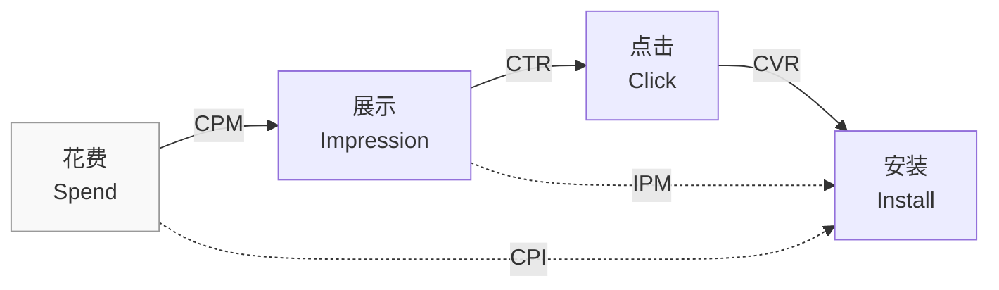

# 从展示到安装：买量的几个基础指标

买量这个过程是这样的：你花钱投了广告。用户在刷手机时，看到你的广告，被吸引住了，顺手点了一下。页面随即跳到应用商店。这时 ta 仍对你的这个产品感兴趣，于是点了下载，马上就打开，或者等会儿再打开。

针对这个过程，如上图所示，就有一组指标来衡量各个环节的情况：

| 指标  | 公式               | 含义        |
| --- | ---------------- | --------- |
| CPM | 花费 / 展示 × 1000   | 每千次展示的价格  |
| CTR | 点击 / 展示          | 展示变点击的比例  |
| CVR | 安装 / 点击          | 点击变安装的比例  |
| IPM | 1000 × CTR × CVR | 千次展示的安装数  |
| CPI | 花费 / 安装          | 获取一个安装的成本 |

## 核心公式

把上面的指标凑在一起，很容易就能得到下面这个公式：

$$
CPI = \frac{CPM}{1000 \times CTR \times CVR} = \frac{CPM}{IPM}
$$

有了这个公式，面对“买量为什么贵了/便宜了”这样的问题，我们就可以拆到具体指标上：是展示买贵了（CPM 涨了），还是漏斗漏得厉害（IPM 掉了）。但是仅拆出是哪个指标还不够，想要在 CPI 变动时做出应对，或者判断要不要应对，还得先弄清各个指标受什么因素影响。

### CPM

影响 CPM 的因素很多，从投放者的角度，值得关注的几个是：市场供需、受众与流量结构、广告质量。

**市场供需**

CPM 的大盘价由供需关系决定，举两个最常见的例子：

一个是季节性的周期波动。Q4 假日季，电商、零售的预算集中下场，同一批用户被更多广告主争抢，全行业 CPM 上涨。Q1 预算收缩，价格回落。根据 AppsFlyer 的数据，电商应用的 CPI 在 2022 年 11 月冲到了当年的最高点（[AppsFlyer: State of eCommerce App Marketing 2023](https://www.appsflyer.com/company/newsroom/pr/ecommerce-app-industry-resilience)）。2025 年又是同样的节奏，三季度广告主就开始为假日季提前放量拉人，全球广告支出一举涨了 24.4%，iOS 的 CPI 单季飙了 44.4%（[Singular Quarterly Report 2025](https://www.singular.net/quarterly-report-2025-q4)）。

另一个是逐年加剧的竞争。玩家数量基本稳定，挤进来抢这些玩家的广告主却越来越多。AppsFlyer 在 2026 年初的报告里直接这么描述：“a significant rise in the number of ads competing for the same pool of players”，争夺同一批玩家的广告明显变多了。落到数据上，2025 年游戏广告展示量涨了 20%，付费安装占比也在上升，盘子没大多少，想分蛋糕的广告主却多了很多（[AppsFlyer: State of Gaming for Marketers 2026](https://www.appsflyer.com/resources/reports/gaming-app-marketing-report)）。

所以 CPM 涨了，应该先看大盘：如果全行业都在涨，那就不是操作上的问题，这种时候应该评估的是在这样的价格下，回收是否能够跟得上支出。如果大盘没动、只有自己的 CPM 涨，这时才需要查自己的池子和质量。

另外，买量和变现是联动的。CPM 上涨的季节，广告变现的 eCPM 往往也在涨。因为假日季抢量的广告主，和买你 App 里广告位的广告主，大多是同一批人。他们预算放大的季节，你买量时每个展示更贵，同时他们的广告涌进你的广告位，你的 eCPM 也更高。Appodeal 的数据里，Q4 的 eCPM 从 10 月起连涨，12 月见顶（[Appodeal: Quarterly Mobile eCPM Report Q4 2024](https://appodeal.com/wp-content/uploads/2025/03/Quarterly_Mobile_eCPM_Report_-_Q4_2024.pdf)）。这种时候只盯着买量侧缩量，可能就错过了变现端同样涨价的窗口。

**受众与流量结构**

不同受众的 CPM 不一样。同样是游戏用户，一个美国用户的潜在价值显然比一个印度用户高得多，广告主自然愿意出更高的价。除了国家地区，品类、设备、版位等等，也都会影响 CPM。

2024 年游戏品类 CPM 的中位数是 $3.41，Casino 却要 $10.97，三倍都不止（[Adjust: The Gaming App Insights Report 2025](https://a.storyblok.com/f/47007/x/8c92516a23/gamingreport2025_ebook_en.pdf)）。Appodeal 2024 年 Q4 的 eCPM 报告里，iOS 一直高于 Android，价差在北美和欧洲格外明显（[Appodeal: Quarterly Mobile eCPM Report Q4 2024](https://appodeal.com/wp-content/uploads/2025/03/Quarterly_Mobile_eCPM_Report_-_Q4_2024.pdf)）。

你的 CPM 是把买到的各个池子加权算出来的平均价。所以大盘没动、你的 CPM 变了，可以考虑预算结构、人群结构是不是变了。

**广告质量**

拍卖并不完全是价高者得。Meta 的官方文档里明确写着，质量排名低的广告 "tend to cost more"，往往更贵（[Meta: About ad quality](https://business.facebook.com/business/help/423781975167984)）。而且这个排名是相对着“争夺同一受众的其他广告”算出来的：别人变好，哪怕你的素材一个字没改，名次也会被压低，出同样的价，能买到的展示就变少了。Google 的竞价公式 Ad Rank 里，广告和落地页的质量同样参与计价，官方原话是 "Higher quality ads can often lead to lower CPCs"，质量越高，单价往往越低（[Google: About Ad Rank](https://support.google.com/google-ads/answer/1722122)）。

尽管两家的计算方式不太一样，但都说明了一件事：质量是算在价格里的，素材和体验上的差距，最后都会体现在你实际付出的 CPM 上。

### CTR

CTR 在买量这个过程中，位于展示和点击之间。广告越吸引人，用户点击它的概率就越高。

要提升 CTR，就要在素材上下功夫：前 3 秒的钩子、内容跟产品贴不贴合等等。而且这个环节的竞争本身就很激烈：2025 年，头部 2% 的素材吃掉了 53% 的广告支出（[AppsFlyer: State of Creative Optimization 2025](https://www.appsflyer.com/resources/reports/creative-optimization-report-2025)）。量都往少数能打的素材上跑，想让人点中你的广告，就得做出自己的特色。

此外，有一个点需要注意：CTR 高当然是我们愿意看到的，但不应将其当做唯一评价指标。如果只追求高点击，但是产出一些和产品内容完全无关的素材，导致后面的链路几乎不转化，那也没有意义。

### CVR

CVR 受素材影响，但卡住它的不止素材：点击到打开之间，隔着商店页（截图、评分、包体大小）、下载（网络、存储）、首次启动（闪退、加载、地区限制），每一段都可能漏人。其中商店页是能直接动手优化的——一般来说：**CTR 低更换素材，CVR 低优化商店页**（[广告中的 Pacing 模型以及冷启动](https://mp.weixin.qq.com/s/u_-DxbuErB8CrFr__FXBEQ)）。Unity 的 Eyewind 案例里，定制商店页让 CVR 提升了 21.5%，IPM 提升了 51%（[Unity: Eyewind Custom Product Pages 案例](https://unity.com/resources/eyewind)），可见商店页的优化确实有效。

不过，CVR 的提升只是提高了用户从点击到安装的比率，它管不到安装之后。和 CTR 类似，我们不能为了一味地提高 CVR，去做一些和产品不搭边的商店页内容。如果用户最后看到的产品内容，和广告素材、商店页展示的不一样，用户同样也会很快流失。

### IPM

IPM 由 CTR 和 CVR 计算得出，把握住了 CTR 和 CVR，也就把握住了 IPM。也正因为它是两个指标的合成，IPM 本身很难直接指导动作：同样 IPM 3 的两个计划，可能是 CTR 3% × CVR 10%，也可能是 CTR 1% × CVR 30%——优化方向完全相反。所以 IPM 掉了之后，必须拆回 CTR 和 CVR 看。

### CPI

最后回到 CPI 上来。同样是 CPI 上涨，拆开看可能是三种完全不同的问题：

- CPM 涨了，CTR/CVR 没动 → 大盘问题：全行业都在涨，观望、换市场，或按新价格重算回收；只有自己在涨，查预算结构和素材质量
- CPM 没动，CTR 跌了 → 素材问题：老素材过了疲劳期，上新变体、换钩子，或换内容方向
- CPM、CTR 没动，CVR 跌了 → 产品侧问题：先查商店页（截图、评分），再查版本变更和下载链路，以及首次启动的闪退和加载

只有把各指标的影响因素搞清楚、拆到位，优化时才能改到真正的问题上。

## 参考

- [AppsFlyer: State of eCommerce App Marketing 2023](https://www.appsflyer.com/company/newsroom/pr/ecommerce-app-industry-resilience)
- [Singular Quarterly Report 2025](https://www.singular.net/quarterly-report-2025-q4)
- [AppsFlyer: State of Gaming for Marketers 2026](https://www.appsflyer.com/resources/reports/gaming-app-marketing-report)
- [Appodeal: Quarterly Mobile eCPM Report Q4 2024](https://appodeal.com/wp-content/uploads/2025/03/Quarterly_Mobile_eCPM_Report_-_Q4_2024.pdf)
- [Adjust: The Gaming App Insights Report 2025](https://a.storyblok.com/f/47007/x/8c92516a23/gamingreport2025_ebook_en.pdf)
- [Meta: About ad quality](https://business.facebook.com/business/help/423781975167984)
- [Google: About Ad Rank](https://support.google.com/google-ads/answer/1722122)
- [AppsFlyer: State of Creative Optimization 2025](https://www.appsflyer.com/resources/reports/creative-optimization-report-2025)
- [广告中的 Pacing 模型以及冷启动](https://mp.weixin.qq.com/s/u_-DxbuErB8CrFr__FXBEQ)
- [Unity: Eyewind Custom Product Pages 案例](https://unity.com/resources/eyewind)