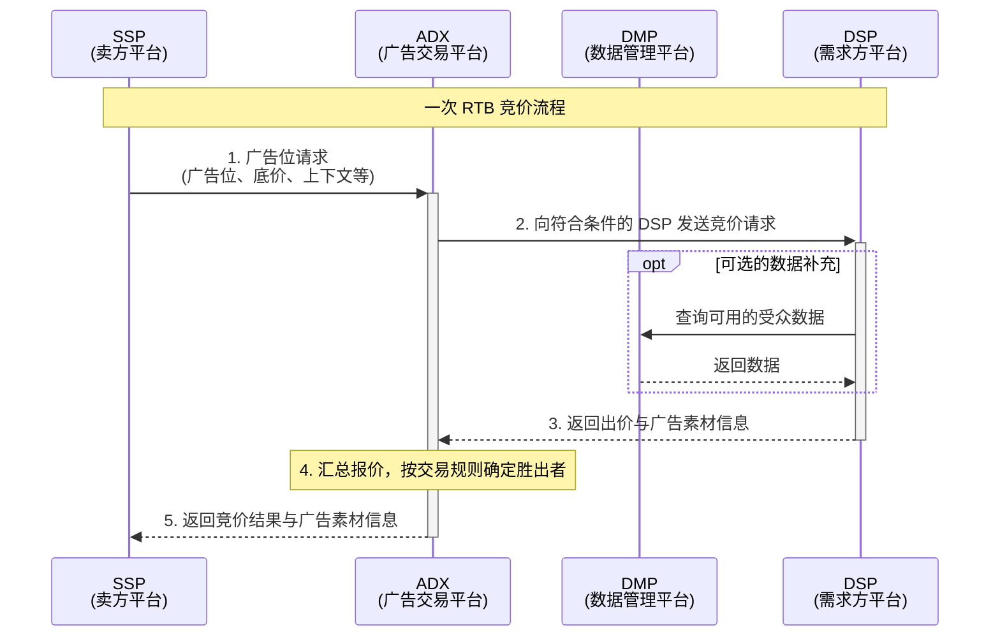

# 从 Request 到展示：程序化广告是如何运作的

## 中间层是怎么长出来的

### 角色层

### 一次展示的旅程

下面是开放市场中一次 RTB 询价与返回的简化流程。DMP 是可选的数据服务，不是每次竞价都必须经过的环节。

### 拍卖规则

各家买方提交报价后，平台需要决定谁获得这次展示，以及胜出者付多少钱。先用一个简化的例子来看：只有一个展示机会，三家买方都满足投放条件，报价分别是 $10、$8 和 $5 CPM，暂时忽略底价、手续费等因素。

**一价与二价**

按一价拍卖，报 $10 的买方胜出，按 $10 CPM 结算。按二价拍卖，同样是它胜出，但按第二高的 $8 CPM 结算。这里的 CPM 是千次展示的计价单位，单次展示的价格还要除以 1,000。

结算方式不同，买方考虑的事情也会不同。

在标准的单物品、私人估值二价拍卖中，按自己的真实估值报价是最优策略。假设你认为这次展示值 $10 CPM：别人最高报 $8，你按 $10 报价就能赢，以 $8 结算。压到 $7 会失去这次本来值得买的展示；抬到 $12，则可能在别人报 $11 时胜出，为只值 $10 的展示付出 $11。报价偏高或偏低，都无法带来更好的结果。[《Networks, Crowds, and Markets》第 9 章](https://www.cs.cornell.edu/home/kleinber/networks-book/networks-book-ch09.pdf)

一价拍卖就需要多考虑一步。即使你认为这次展示值 $10，也未必愿意直接报 $10。如果报 $8.10 就能赢，按 $10 成交就多花了钱。但你在出价时并不知道其他人的报价，压低多少才合适，需要估计。

**实际平台采用什么规则**

具体平台的规则，要查对应交易系统的文档。AppLovin 明确说明，MAX In-App Bidding Exchange 采用统一一价拍卖；Unity 的 ironSource Exchange 接口也明确只支持一价拍卖。[AppLovin：Auction Dynamics](https://support.applovin.com/en/max/demand-partners/auction-dynamics)、[Unity：OpenRTB 规格](https://docs.unity.com/en-us/grow/programmatic/ironsource-exchange/openrtb-specs)

Google Ad Manager 则在 2019 年推进了从二价到统一一价的迁移。Google 当年 9 月的公告说明，Ad Exchange 流量已完成切换，仅短期保留少量二价流量用于监测。[Google：2019 年 9 月更新公告](https://support.google.com/authorizedbuyers/answer/9539164?hl=en)

这里还要区分两个概念：in-app bidding 描述应用内的广告需求如何参与竞价，一价、二价描述胜出后的结算方式。看到某个平台支持 bidding，还需要继续确认它的拍卖规则。

**Bid shading**

一价拍卖下，DSP 会尝试估计竞争价格，在获胜概率与成交成本之间选择合适的报价。这类出价调整通常称为 bid shading。

沿用前面的例子，买方估值为 $10，实际报价可能只有 $8.10。这个数字来自对市场价格的预测，并不能保证每次都刚好超过对手。压得过低会丢失展示，压得太少又可能多付钱。相关研究因此把问题表述为成本与竞胜概率之间的权衡。[KDD 2021：An Efficient Deep Distribution Network for Bid Shading in First-Price Auctions](https://arxiv.org/abs/2107.06650)

### 出价能力

### 媒体侧的玩法

### Pacing 与预算节奏

## 参考

- [AppLovin：MAX Auction Dynamics](https://support.applovin.com/en/max/demand-partners/auction-dynamics)
- [Unity：ironSource Exchange OpenRTB 规格](https://docs.unity.com/en-us/grow/programmatic/ironsource-exchange/openrtb-specs)
- [Unity：LevelPlay In-App Bidding](https://docs.unity.com/en-us/grow/levelplay/platform/fundamentals/in-app-bidding)
- [Unity Blog：Why Unity is Moving to 100% In-App Bidding](https://unity.com/blog/unity-moving-to-in-app-bidding)
- [Google Ad Manager Help：How Open Bidding Works](https://support.google.com/admanager/answer/7128958)
- [Google AdMob Help：Guide to AdMob Mediation](https://support.google.com/admob/answer/13420272)
- [Google Blog：More Effective Media Buying on Apps](https://blog.google/products/ads-commerce/more-effective-media-buying-on-apps/)
- [Meta：Audience Network Bidding Overview](https://developers.facebook.com/docs/audience-network/bidding/overview/)
- [Meta：Audience Network 转 Bidding-Only（2021）](https://www.facebook.com/audiencenetwork/resources/blog/audience-network-to-become-bidding-only-beginning-with-ios-in-2021)
- [IAB Tech Lab：OpenRTB](https://iabtechlab.com/standards/openrtb/)
- [IAB Tech Lab：ads.txt](https://iabtechlab.com/ads-txt/)
- [IAB Tech Lab：sellers.json](https://iabtechlab.com/sellers-json/)
- [BidSwitch Blog：OpenRTB 3.0 采用现状](https://blog.bidswitch.com/openrtb-3.0-what-is-it-and-why-is-almost-nobody-using-it-yet)
- [AdExchanger：The Rise of Header Bidding（2015）](https://www.adexchanger.com/publishers/the-rise-of-header-bidding-and-the-end-of-the-publisher-waterfall/)
- [AdExchanger：Everything You Need to Know About Bid Shading（2019）](https://www.adexchanger.com/online-advertising/everything-you-need-to-know-about-bid-shading/)
- [AdExchanger：In-App Bidding Gathers Steam（2020）](https://www.adexchanger.com/mobile/in-app-bidding-gathers-steam-but-adoption-looks-nothing-like-header-bidding-on-the-web/)
- [AdExchanger：Facebook Audience Network 加速转 Bidding-Only（2020）](https://www.adexchanger.com/mobile/facebook-accelerates-plans-to-go-bidding-only-for-audience-network-due-to-coming-idfa-changes/)
- [DOJ 诉讼披露：Google 2019 年一价迁移文件](https://www.justice.gov/atr/media/1368906/dl)
- [yieldmonk：AdMob 2025 年更新转述](https://yieldmonk.com/blog/google-admob-new-bidding-partners-and-mediation-updates/)
- [PPC Land：Mediation Waterfall 综述](https://ppc.land/mediation-waterfall/)
- [出海流量研究僧：广告竞价背后的逻辑和模型算法（一）](https://mp.weixin.qq.com/s/j_6-scCu9kT5q4bV46owXw)
- [出海流量研究僧：广告竞价背后的逻辑和模型算法（二）](https://mp.weixin.qq.com/s/-J32qdYLv7FqkoOIafP9VQ)
- [广告中的 Pacing 模型以及冷启动](https://mp.weixin.qq.com/s/u_-DxbuErB8CrFr__FXBEQ)
- 刘鹏《计算广告：互联网商业变现的市场与技术》（书目条目，链接格式待定）
